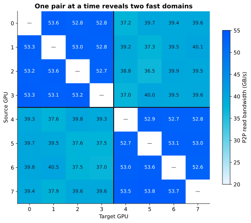
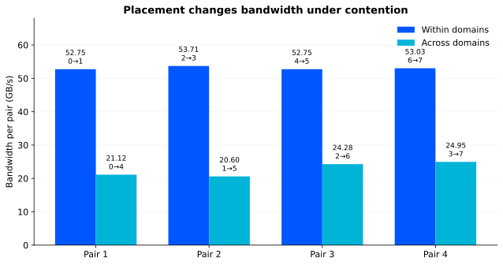
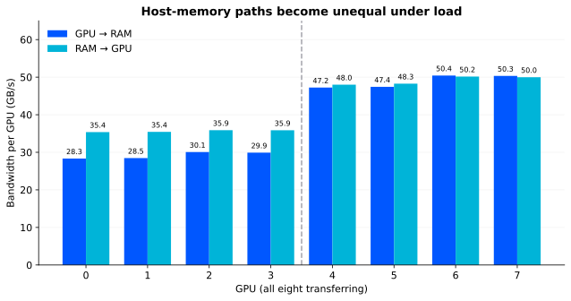

<style>
.content figure { margin: 2rem 0; }
.content figure img { width: 100%; height: auto; display: block; }
.content figcaption { font-size: 0.82rem; line-height: 1.6; color: var(--muted); margin-top: 0.7rem; }
.content .paper-byline { font-size: 0.8rem; letter-spacing: 0.06em; }
.content .lead-result { font-size: 1.1rem; color: var(--text); }
.content .takeaways { border-left: 4px solid var(--blue); background: var(--off); padding: 1rem 1.4rem 0.2rem; margin: 1.5rem 0; }
.content .takeaways h2 { margin-top: 0; }
@media (max-width: 900px) { .content h1 { white-space: normal; } }
@media (max-width: 700px) { .content table { display: block; overflow-x: auto; } }
</style>

# Making the Most of PCIe GPUs

<p class="paper-byline">Diego Bardella · Dielabs · November 2026</p>

## Measured lessons from an eight-GPU, air-cooled cloud server

**Lab:** Dielabs · **Provider:** Verda, FIN-03 · **Hardware:** 8 × NVIDIA RTX PRO 6000 Blackwell Server Edition · **Measured:** 9 October 2026 · **Scope:** infrastructure precheck, before LLM serving

<p class="lead-result"><strong>Four simultaneous GPU pairs sustained about 53 GB/s each when placed within the same NUMA domain, and 21–25 GB/s when placed across them. The hardware stayed the same. Placement changed the available bandwidth by more than twofold.</strong></p>

<div class="takeaways" markdown="1">

## What this test teaches

- Qualify the paths your workload will use, including simultaneous transfers. A GPU specification does not describe a whole server.
- Measure effective topology inside a VM. The topology exposed to the guest can look uniform while performance is not.
- Keep heavy GPU-to-GPU exchanges within a NUMA domain; test RAM traffic separately before choosing an offload layout.
- Validate cooling with all GPUs loaded. In this five-minute test, eight GPUs near 600 W each reached at most 71 °C, with no thermal slowdown reported.
- Treat these measurements as inputs to an application benchmark. They do not establish LLM throughput, an NVLink comparison, or a long-duration thermal qualification.

</div>

## 1. The practical question

How do you get the most from a multi-GPU PCIe server? Start by discovering which transfers can run independently and which compete for a shared path. That matters when choosing GPUs for replicas, prefill/decode separation, or KV cache offload.

This investigation began as a precheck for KVBench, a planned LLM serving experiment. An earlier session on a four-GPU Verda instance had left a small asymmetry unexplained. Renting an eight-GPU instance let us test a larger configuration and expose a much clearer structure. The two sessions used different locations, so the four-GPU node is context, not a controlled half-server comparison.

The useful outcome is a qualification method for this class of infrastructure. PCIe and air cooling deserve evaluation against the workload's actual communication and thermal requirements. This session shows what one such node delivered, where it slowed down, and how placement can use it better.

## 2. The node and the measurement method

| Component | Observed configuration |
| --- | --- |
| Instance | Verda `8RTXPRO6000.240V`, FIN-03, spot |
| Virtualization | KVM; one NUMA node visible to the guest |
| CPU presentation | AMD EPYC 9555 model string; 240 vCPUs |
| RAM | Approximately 708 GiB reported by the guest |
| GPUs | 8 × RTX PRO 6000 Blackwell Server Edition; 97,887 MiB visible per GPU; ECC enabled |
| GPU links | PCIe Gen5 ×16 under load; no NVLink in this configuration |
| Power limits | 600 W on every GPU |
| Driver / toolkit | NVIDIA 580.178.04; driver-reported CUDA 13.0; toolkit/runtime 13.2 |
| Transfer measurement | NVIDIA nvbandwidth v0.10.0, copy-engine tests |
| Stress and telemetry | gpu-burn, nvidia-smi, session monitoring with hw-smi |

The session covered host identification, GPU topology, isolated and simultaneous transfers, selected GPU subsets, buffer-size sweeps, latency, and a five-minute all-GPU stress test. Selected anomalous subsets were repeated. For concurrent GPU pairs, four nvbandwidth processes ran in parallel with 30 iterations requested per process.

This was an exploratory session of approximately 35–40 minutes, not a repeated campaign across nodes. The retained notes contain transfer matrices, selected commands, stress-test output and a thermal summary. The thermal CSV in the notes is an excerpt, not the full time series. Exact source commit hashes and all invocation defaults were not retained there; the appendix records the available evidence without implying a fully reconstructible experiment.

Bandwidth below is in GB/s as reported by nvbandwidth. A pairwise matrix measures one pair at a time: summing all its cells does **not** give the server's simultaneous bandwidth. Bidirectional totals, where discussed, are the sum of both directions and are not comparable to a one-way value without that distinction.

## 3. Read the topology, then test it

The guest reported one NUMA node. `nvidia-smi topo -m` showed PHB between every GPU pair, and the P2P read capability check reported OK everywhere. That established what the software exposed, but did not establish equal performance.

The one-pair-at-a-time P2P read matrix split cleanly into two groups:

| Path | One-way bandwidth |
| --- | --- |
| Within GPU 0–3 | 52.7–53.6 GB/s |
| Within GPU 4–7 | 52.6–53.8 GB/s |
| Between the two groups | 36.5–40.5 GB/s |

<figure>

<figcaption>Figure 1. P2P read bandwidth, one pair at a time. The two NUMA domains emerge from measurement despite uniform guest-visible topology labels.</figcaption>
</figure>

Writes showed the same grouping. Bidirectional pair totals were about 101 GB/s within a group and 70–75 GB/s between groups.

**Best practice:** build a bandwidth matrix before assigning communication-heavy roles. Label the resulting groups as NUMA domains. Here they correspond to the host's two CPU sockets: the guest exposed a single NUMA node, but the measurements show two.

## 4. Contention turns topology into a placement decision

The next test used four GPU pairs at the same time. This approximates the transfer pressure of several prefill workers handing KV data to decode workers, without running an inference engine.

| Placement | Pairs | GB/s per pair | Sum of concurrent pairs |
| --- | --- | --- | --- |
| Within domains | 0→1, 2→3, 4→5, 6→7 | 52.75, 53.71, 52.75, 53.03 | 212.24 GB/s |
| Across domains | 0→4, 1→5, 2→6, 3→7 | 21.12, 20.60, 24.28, 24.95 | 90.95 GB/s |

<figure>

<figcaption>Figure 2. Four simultaneously active pairs. Across-domain aggregate bandwidth was about 43% of the within-domain result. This ratio describes transfer bandwidth, not LLM serving speed.</figcaption>
</figure>

Within domains, each pair retained approximately its isolated bandwidth. Across domains, each fell below its isolated 36.5–40.5 GB/s. The results are consistent with a shared bottleneck between the groups; they do not identify its physical implementation or prove its absolute capacity.

For a proposed four-prefill/four-decode layout, a useful starting point is two cells: prefill on 0,1 and decode on 2,3; prefill on 4,5 and decode on 6,7. Routing must preserve these pairings. Putting all prefill workers on 0–3 and all decode workers on 4–7 would force every KV handoff across the slower boundary. The exact two-prefill/two-decode routing pattern remains to be tested; the measured within-domain pairs used a different assignment.

**Best practice:** run the expected number of simultaneous exchanges. Use their results to choose placement, then verify the proposed mapping in the real serving stack. A device list alone does not guarantee that a scheduler or router preserves locality.

### Translating bandwidth into a transfer budget

For illustration, assume 80 layers, 8 KV heads, head dimension 128 and BF16 KV elements. The KV payload per token is:

```text
2 (K and V) × 80 × 8 × 128 × 2 bytes = 327,680 bytes/token
8,000 tokens = 2.62144 GB of KV
```

A single bulk transfer of that payload takes approximately 49 ms at 53 GB/s, 69 ms at 38 GB/s, or 119 ms at 22 GB/s. These are payload/bandwidth estimates. Actual transfer formats, cache dtype, block layout, protocol overhead and overlap with computation change the result. Model-weight FP8 does not itself specify KV cache dtype.

Use this calculation to ask whether transfer fits the latency budget. It is not a TTFT measurement and does not establish a benefit from disaggregation.

## 5. RAM offload needs its own placement map

With one GPU at a time, host-to-GPU bandwidth was about 57.9 GB/s on every device, and GPU-to-host about 56.6 GB/s. The apparent symmetry disappeared when all eight transferred together.

| Simultaneous direction | GPUs 0–3, per GPU | GPUs 4–7, per GPU | Aggregate |
| --- | --- | --- | --- |
| GPU → RAM | 28.3–30.1 GB/s | 47.2–50.4 GB/s | 312.18 GB/s |
| RAM → GPU | 35.4–35.9 GB/s | 48.0–50.2 GB/s | 338.98 GB/s |

<figure>

<figcaption>Figure 3. All eight GPUs active. Host-memory traffic exposes an asymmetry that isolated transfers conceal.</figcaption>
</figure>

Subset tests refined the picture. With 0,1,4,5 active, GPUs 0 and 1 reached about 39 GB/s on RAM→GPU, while 4 and 5 reached about 58. Repeating that selection reproduced the slowdown. With **0,2,4,6**, all four reached about 57.9 GB/s on RAM→GPU and 56.6 GB/s on GPU→RAM.

This suggests shared resources finer than the two NUMA domains. Host RAM placement may also contribute. The guest's single NUMA node gives no verified way to bind to the physical memory locality inferred from these measurements.

**Best practice:** test host traffic independently, in both directions and with the intended active subsets. For this session, 0,2,4,6 was a promising four-worker selection for RAM bandwidth. Those indices are not a portable recommendation: repeat discovery after a new allocation.

For KV offload, bandwidth is only part of the decision. A 640 MiB payload would take roughly 12 ms at 58 GB/s or 19 ms at 36 GB/s before software overhead. Whether that beats recomputation must be measured with the actual model, cache implementation and concurrency. This precheck does not settle it.

## 6. Match transfer sizes to the application

A large-buffer result does not describe every message size.

| Buffer per transfer | 0→1, within domain | 0→4, across domains |
| --- | --- | --- |
| 1 MiB | 36.71 GB/s | 35.85 GB/s |
| 4 MiB | 49.53 GB/s | 40.16 GB/s |
| 16 MiB | 53.78 GB/s | 40.90 GB/s |
| 64 MiB | 54.51 GB/s | 38.72 GB/s |

At 1 MiB, the two paths were close; at larger sizes their difference became clearer. Fixed transfer costs matter more for small payloads. Efficient coalescing can improve bandwidth while making path differences more visible.

**Best practice:** sweep realistic buffer sizes, then inspect the transfer sizes the serving library actually generates. NIXL was not exercised here, so its behavior cannot be inferred directly from these bulk copies.

## 7. Air cooling: qualify the whole node under load

The eight-GPU air-cooled platform sustained the short all-GPU stress test without a thermal slowdown signal. Per-GPU summaries for samples at at least 90% utilization were:

| Metric | Observed range or result |
| --- | --- |
| Average GPU temperature | 66.5–68.2 °C |
| Maximum GPU temperature | 71 °C |
| Average power per GPU | 594.4–597.2 W |
| Average SM clock per GPU | 2,208–2,249 MHz |
| Thermal slowdown | None reported |
| Power-cap activity | Reported in 99–100% of retained high-utilization samples |
| gpu-burn outcome | All eight passed, no errors reported |
| ECC counters | Enabled; zero corrected and uncorrected volatile errors at check time |

The GPUs alone drew approximately 4.77 kW in aggregate. That is GPU telemetry, not measured server wall power. Power-cap activity was expected near the configured 600 W limit and must be distinguished from thermal slowdown. Average clocks differed by roughly 1.9% from lowest to highest; this does not prove identical inference performance.

The result supports the use of this air-cooled node for further testing at the configured power limit. A VM cannot reveal inlet temperature, fan policy, rack conditions or the facility cooling design. Five minutes also cannot establish long-term thermal equilibrium or reliability.

**Best practice:** load all devices together and record temperatures, clocks, power, thermal reasons and errors. For production qualification, extend the run and include the real workload. Air cooling can be evaluated with the same evidence discipline as any other design choice.

## 8. Prepare the software before starting the paid experiment

The first gpu-burn attempt failed on all devices with an unsupported PTX toolchain error. The session used toolkit 13.2 with a driver reporting CUDA 13.0. Rebuilding the test kernel as native code for this GPU architecture allowed the stress test to run:

```bash
nvcc -arch=sm_120 -fatbin compare.cu -o compare.fatbin
```

That was a workaround for this specific test, not a general promise that native compilation fixes every driver/toolkit mismatch. Validate the application and container on the intended hardware and use a supported software combination.

Model staging also belongs in preparation. The network tests at FIN-03 were slower and more variable than in the earlier FIN-01 session, but those measurements do not isolate datacenter, source-server or time-of-day effects. Stage downloads early and measure the actual source path rather than planning from a cloud-network headline.

**Best practice:** prepare scripts, record exact tool versions and source commits, preserve full logs, and test representative binaries before the main run. Export evidence before deleting an ephemeral instance.

## 9. An acceptance card for PCIe GPU infrastructure

| Check | Evidence to retain | Decision it supports |
| --- | --- | --- |
| Identity and links | GPU model, memory, power limit, link width/generation under load, software versions | Confirm the delivered configuration |
| Pairwise GPU traffic | Read/write matrices and P2P support | Discover fast communication groups |
| Concurrent GPU traffic | Intended simultaneous pairs and their aggregate | Place workers without overloading shared paths |
| Host-memory traffic | Both directions, all GPUs and chosen subsets | Select and qualify offload workers |
| Transfer granularity | Buffer-size sweep and application transfer sizes | Budget transfer overhead realistically |
| Whole-node health | Sustained load, clocks, power, thermal reasons, errors | Accept the operating envelope |
| Application validation | TTFT, ITL, throughput, tails and errors under the target workload | Confirm the infrastructure choices improve service |

For independent replicas, keep model weights and active state local where possible. For prefill/decode separation, make KV transfer follow the measured fast paths. For RAM offload, qualify the host path independently. For tensor parallelism, run the actual collectives and model: pairwise copy bandwidth alone cannot predict all-reduce performance.

## 10. What the precheck establishes—and what comes next

This node delivered approximately 53 GB/s per concurrent within-domain pair, useful host-memory bandwidth, and a clean short thermal test with eight GPUs near their power limits. It also exposed substantial penalties when transfers crossed NUMA domains or selected host-memory paths competed.

For scale: NVLink 5 on Blackwell data-center GPUs is specified at 1.8 TB/s bidirectional per GPU (about 900 GB/s per direction), roughly 17× the ~53 GB/s per pair measured here within a NUMA domain. This is a comparison with a specification, not a measurement ([NVIDIA](https://developer.nvidia.com/blog/upgrading-multi-gpu-interconnectivity-with-the-third-generation-nvidia-nvswitch)).

The resulting practice is straightforward: **discover the effective topology, exercise it under contention, and place the workload according to the measured paths.** That is how a PCIe server becomes a known infrastructure resource rather than eight interchangeable device numbers.

The next experiment is to compare topology-aware and deliberately crossing layouts with an actual LLM, including routing, cache transfers and offload. No model was loaded in this session. There is no measured NVLink comparison, liquid-cooling comparison, cost-per-token result or multi-node replication here. The findings describe one Verda VM on one date; the qualification method is the reusable contribution.

## Appendix: evidence and tools

The downloadable [measurement extracts](/assets/papers/making-the-most-of-pcie-gpus/measurements.json) contain the exact matrix and values used in the three figures, selected subset results, the buffer sweep and per-GPU thermal summaries. They were transcribed programmatically from the retained session notes. They are a curated evidence set, not the original complete log archive. The [CSV matrix](/assets/papers/making-the-most-of-pcie-gpus/p2p-read.csv) also exposes the pairwise read matrix for reuse.

Commands retained in the session notes include:

```bash
nvidia-smi topo -m
nvidia-smi topo -p2p r
# Selected host-memory subsets; test IDs refer to the session's v0.10 build:
CUDA_VISIBLE_DEVICES=0,2,4,6 nvbandwidth -t 8 10
# Pair test, launched concurrently for each selected pair:
CUDA_VISIBLE_DEVICES=0,1 nvbandwidth -t 4 -i 30
# Buffer sweep (MiB); repeat with 4, 16 and 64 and the other pair:
CUDA_VISIBLE_DEVICES=0,1 nvbandwidth -t 4 -b 1
```

Check test names and arguments against the installed build before reuse; numeric IDs can change. The concurrent-pair command above is one process in a four-process test, not the whole experiment.

Tool references: [NVIDIA nvbandwidth](https://github.com/NVIDIA/nvbandwidth) and [gpu-burn](https://github.com/wilicc/gpu-burn). These document the measurement tools; the numerical findings here are from the Dielabs session.

Related Dielabs work: [What CPUs Teach About GPU Inference](what-cpus-teach-about-gpu-inference.html), [When Offloading Doesn't Offload](when-offloading-doesnt-offload.html), and [The Shifting Bottleneck](the-shifting-bottleneck.html).
