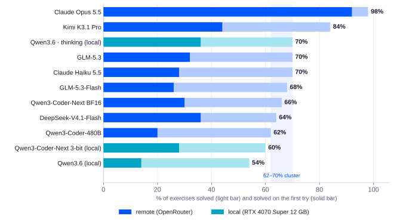
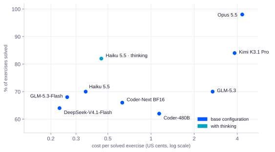
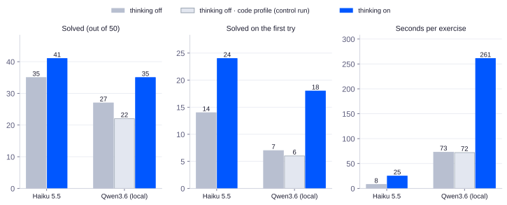
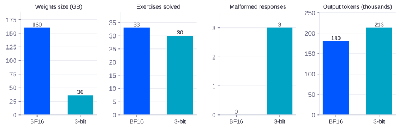

# What It Costs to Be Right

## Coding Benchmark @Dielabs: a journey inside LLMs

<strong>Lab:</strong> Dielabs &nbsp;<strong>Benchmark:</strong> Aider Polyglot, 50 fixed exercises in 6 languages &nbsp;<strong>Local:</strong> llama.cpp on RTX 4070 Super 12 GB VRAM, 32 GB RAM &nbsp;<strong>Remote:</strong> pinned providers via OpenRouter &nbsp;<strong>Measured:</strong> November 2026 (prices as of 4 November 2026)

17 LLM configurations, 50 coding exercises: quality, cost and time. What they tell us about how models work, and how (and where) to choose them.

<a class="pdf-link" href="/assets/papers/what-it-costs-to-be-right/what-it-costs-to-be-right.pdf">Download the PDF</a>

## In short

We measured 17 configurations of 10 models (16 planned plus one control run) on the same 50 programming exercises in six languages, with automated tests deciding the outcome: 13 configurations completed all 50 exercises, 4 were stopped early. Besides the score we recorded first-try passes, malformed responses, tokens, time and cost. The main findings:

- **One model is in a league of its own.** Claude Opus 5.5 solves 49 exercises out of 50, 46 on the first try. The runner-up, Kimi K3.1 Pro, solves 42, but only 22 on the first try.
- **Below that, a tight cluster.** Six remote configurations between 62% and 70%, very different in size and price, land close together. With 50 exercises the uncertainty is wide: this first campaign is not enough to rank them, only to group them into tiers.
- **Within the cluster, price varies more than tenfold.** GLM-5.3 scores close to GLM-5.3-Flash (70% vs 68%) and the same as Haiku 5.5, at a cost per solved exercise up to 10 times higher.
- **Size alone does not predict the result.** 2026 general-purpose models, even with fewer declared active parameters, match or beat the 2025 Qwen3-Coder-480B, which is specialized for code.
- **Reasoning (test-time compute) works, but it is a trade-off.** On the local node, with the same sampling settings, enabling thinking on Qwen3.6 increased solved exercises from 22 to 35 out of 50. First-try passes rose from 6 to 18, while average time per exercise rose from 72 to 261 seconds. Haiku, where only reasoning changes, goes from 35 to 41. At high doses, GLM-5.3-Flash and DeepSeek-V4.1-Flash become too slow for real use.
- **In this test, quantization took away little compared to what it saves.** Qwen3-Coder-Next at 3 bits takes about 77% less space than the BF16 version and solves 3 fewer exercises out of 50, a gap that with these numbers may well be chance. In our comparison, which also changes the runtime environment, a few malformed responses and more output tokens appear.
- **On the local node, the best coding model is the everyday one, as long as you let it think.** Qwen3.6 with thinking reaches 70%, close to the cheap cloud models, paying for it in time.

---

## 1. Why this benchmark

Anyone proposing private AI to clients has to answer concrete questions: which model to use for writing code, how much you lose by staying on your own hardware, what a correct answer really costs, whether reasoning is worth turning on. Public benchmarks help little: they are often measured by the vendors with their own harness, on different tasks, and they say nothing about our hardware.

The goal was therefore a **repeatable** method that Dielabs can run again the same way, with results comparable over time. This paper collects the first day of measurements and what can be learned from it: about the models, how they work, and the infrastructure choices around them.

---

## 2. Method

### The benchmark and the score

We use **Aider Polyglot**: Exercism exercises in C++, Go, Java, JavaScript, Python and Rust (225 in total). We extracted **50 fixed ones** with seed 42, proportional to the languages (C++ 6, Go 9, Java 10, JavaScript 11, Python 7, Rust 7). Aider's own subset command samples at random without a seed, so we built the list ourselves: every model sees the same exercises.

For each exercise the model receives the instructions and a nearly empty file; it does not see the tests. It replies with its edits, Aider applies them and runs the language's official tests. If they all pass, the exercise is solved on the first try. If not, the model receives the test output in the same conversation, with a request to fix the code without touching the tests, and gets a **second try**. An exercise only counts if all its tests pass.

The **score** is the percentage of exercises solved within two tries, as in Aider's standard.

Alongside it we track two efficiency indicators:

- **First try:** how often the model gets there on its own, without help from the errors. It is the strictest measure.
- **Malformed responses:** edits that cannot be applied to the file because the block to be replaced does not match the actual code. Aider flags them and allows up to three fixes within the same try; if that is not enough, the exercise can fail. They are wasted rounds, and sometimes lost points.

### Fixed rules

| Parameter | Value |
| --- | --- |
| Edit format | diff (search/replace blocks) |
| Tries | 2 |
| Parallelism | 1 exercise at a time |
| Sampling | values recommended by each model's vendor |
| Thinking | off where possible; minimum (low) where mandatory; on only in dedicated experiments |
| Remote provider | pinned, with no automatic fallback to other providers |
| Remote quantization | FP8 or higher where available |

**Local.** Local models run on llama.cpp in a k3s pod on the Dielabs node: RTX 4070 Super 12 GB GPU, i7-14700F CPU, 32 GB DDR5 RAM. All of them run partly in VRAM and partly in RAM: the MoE (Mixture of Experts) models keep part of their experts in RAM. Unsloth dynamic quantizations: 4-bit for Qwen3.6 and Coder-30B, 3-bit for Coder-Next.

**Remote.** Remote models go through OpenRouter, with the provider pinned based on its declared quantization. Anthropic does not declare quantization. Kimi K3.1 Pro is served in MXFP4, which matches the native format of the weights released by Moonshot (same file structure as Kimi K3, trained to be quantization-aware): it is not compression added by the provider.

**Costs.** The cost of each run is estimated as measured tokens × list price of the provider used, taken from OpenRouter's public API on 4 November 2026; all providers and prices are in Appendix B. The estimates add up to $5.85; actual spend read on the API key was $7.38, including preliminary tests, provider checks and requests left open in interrupted runs.

**Precision.** With 50 exercises the uncertainty of each score is wide: for a 70% score the 95% confidence interval runs from about 56% to 81% (Appendix C). To compare two configurations, the gap between scores is not enough: what also matters is how many exercises each one solves where the other fails. Two models 7 exercises apart are clearly different if one never loses where the other wins, much less so if they are good at different exercises (examples in Appendix C).

---

## 3. Overall results

<figure>
  
  <figcaption>Chart 1. Score (light bar) and solved on the first try (solid bar). Base configurations, 50 complete exercises. The highlighted band (62–70%) is descriptive: it marks results that are close, not statistical equivalence.</figcaption>
</figure>

The table lists all base configurations. Cost per solved exercise is in US cents. Local models have no API cost; local costs (energy, hardware depreciation) are not estimated.

| Model | Where | Quant. | Thinking | Score | 1st try | Malf. | Tokens out / ex. | s / ex. | Run cost $ | ¢ per solved |
| --- | --- | --- | --- | --- | --- | --- | --- | --- | --- | --- |
| Claude Opus 5.5 | Anthropic | n/a | low\* | **98%** | 46 | 0 | 1,101 | 10 | 2.12 | 4.33 |
| Kimi K3.1 Pro | Moonshot AI | MXFP4\* | low | **84%** | 22 | 0 | 1,655 | 56 | 1.61 | 3.83 |
| Qwen3.6-35B-A3B · thinking | local | 4-bit | on | **70%** | 18 | 0 | 11,629 | 261 | — | — |
| GLM-5.3 | Z.AI | FP8 | low\* | **70%** | 16 | 7 | 1,130 | 18 | 0.94 | 2.69 |
| Claude Haiku 5.5 | Anthropic | n/a | off | **70%** | 14 | 1 | 1,612 | 8 | 0.12 | 0.35 |
| GLM-5.3-Flash | Z.AI | FP8 | low\* | **68%** | 13 | 3 | 986 | 16 | 0.09 | 0.26 |
| Qwen3-Coder-Next | Parasail | BF16 | none | **66%** | 15 | 0 | 3,599 | 49 | 0.21 | 0.63 |
| DeepSeek-V4.1-Flash | DeepInfra | FP8 | off | **64%** | 18 | 2 | 1,125 | 15 | 0.08 | 0.23 |
| Qwen3-Coder-480B | Venice | FP8 | none | **62%** | 10 | 3 | 2,103 | 24 | 0.35 | 1.14 |
| Qwen3-Coder-Next | local | 3-bit | none | **60%** | 14 | 3 | 4,251 | 226 | — | — |
| Qwen3.6-35B-A3B | local | 4-bit | off | **54%** | 7 | 3 | 2,592 | 73 | — | — |

*Thinking low\* = minimum level, because the provider does not allow turning it off. MXFP4\* = native weight format. Local quantizations: Unsloth UD-Q4_K_XL and UD-Q3_K_XL. Score = solved within two tries out of 50. Tokens out / ex. = tokens generated per exercise (reasoning tokens included). Costs estimated as described in the Method. Seconds per exercise are end-to-end: both tries and test runs, plus network and provider service for remote models. They can be compared across deployments as total wait time; isolating inference speed would require separate measurements.*

---

## 4. Reading the data by group

### The flagship models

**Claude Opus 5.5** is the only one that hardly needs the second try: 46 exercises out of 50 on the first attempt, zero malformed responses, the only one to solve all 10 Java exercises. It misses a single exercise, one that no complete configuration in the test solved.

**Kimi K3.1 Pro**, the best open model in the test, scores 84%: it pulls away from the central cluster (on the same exercises it wins 10 to 3 against GLM-5.3, a signal but not yet proof), but on the first try it stops at 22, less than half of Opus. It gets there, but needs the correction round much more often. Per solved exercise it costs almost as much as Opus (3.8 vs 4.3 cents): in the cloud it is a grey zone. Its argument is openness: it is the choice when a closed model is not allowed.

**GLM-5.3**, Z.ai's open flagship (744B parameters, 40B active), stays in the central cluster at 70%, has the highest number of malformed responses in the test (7) and costs about ten times its Flash sibling for one extra exercise.

### The central cluster of cheap models

<figure>
  
  <figcaption>Chart 2. Score against cost per solved exercise (log scale). Remote models, 50 complete exercises; in teal the configuration with thinking.</figcaption>
</figure>

Haiku 5.5, GLM-5.3-Flash, DeepSeek-V4.1-Flash, Qwen3-Coder-Next and Qwen3-Coder-480B all sit between 62% and 70%. The results are close and this campaign cannot rank them with confidence: Haiku 5.5 and GLM-5.3, for example, solve 35 each, but each wins 8 exercises the other loses. The choice is therefore made on other axes:

- **Price:** DeepSeek-V4.1-Flash (0.23 ¢), GLM-5.3-Flash (0.26 ¢) and Haiku 5.5 (0.35 ¢) per solved exercise.
- **First try:** DeepSeek-V4.1-Flash is the best of the group (18).
- **Speed:** Haiku 5.5 is the fastest in the test (8 seconds per exercise).
- **Discipline:** Qwen3-Coder-Next in BF16 produces no malformed responses at all (the local 3-bit version produced 3).
- **Open weights:** GLM-5.3-Flash and DeepSeek-V4.1-Flash are open and served by dozens of providers, so pricing is competitive and you can switch provider without switching model. Haiku is closed.

### The code-specialized models

The Qwen3-Coder line (30B, 480B, Next) has no thinking by design: it is meant to work inside an agent, where context comes from the environment (executions, tests, errors) rather than from reasoning. In the test the "Coder" label gave no advantage: the 480B (62%) trails smaller and newer general-purpose models, and the 4-bit Coder-30B was stopped at 44 exercises with 11 solved. Coder-Next remains interesting for its discipline (in BF16) and because it is the only one of the group that runs on our node, using VRAM (12 GB) and RAM (32 GB) together.

### The local node

| Local model | Quant. | Thinking | Score | 1st try | Malf. | s / ex. | Generation |
| --- | --- | --- | --- | --- | --- | --- | --- |
| Qwen3.6-35B-A3B | 4-bit | off | 54% | 7 | 3 | 73 | ~63–66 tokens/s |
| Qwen3.6-35B-A3B | 4-bit | on | 70% | 18 | 0 | 261 | as above, ~4× tokens |
| Qwen3-Coder-Next | 3-bit | — | 60% | 14 | 3 | 226 | ~37–41 tokens/s |
| Qwen3-Coder-30B-A3B | 4-bit | — | 11/44 | 3 | 1 | 91 | ~42–43 tokens/s |

Three observations. **First:** 3-bit Coder-Next and Qwen3.6 with thinking take the same time per solved exercise (about 375 seconds): the first is faster but solves fewer exercises, the second is slower but solves more. **Second:** Coder-Next saturates the node (36 GB across RAM and VRAM), while Qwen3.6 leaves headroom and also serves chat and search. **Third:** Coder-30B is slower than Qwen3.6 despite being smaller, because it uses classic attention on all 48 layers: its KV cache is about five times heavier (estimate: ~96 KB per token vs ~20 KB), and it takes VRAM away from the experts.

---

## 5. Theories put to the test

### Size alone does not predict the result

GLM-5.3-Flash (320B total, 18B active, August 2026) and Haiku 5.5 beat Qwen3-Coder-480B (35B active, July 2025): with about half the declared active parameters in GLM-5.3-Flash's case (18B vs 35B; for Haiku the figure is not public), the result is the same or better. The same holds between siblings: GLM-5.3 (744B) adds a single exercise over GLM-5.3-Flash. The test does not isolate the causes (training, architecture, reasoning, compatibility with the test tool), so it does not say why; it does show that size, on its own, is not enough to predict the score. The most likely explanation is progress in code training from one generation to the next.

> **Rule of thumb:** don't pick a model by size or by label: measure it.

### Test-time compute: intelligence in the weights or in the context

The benchmark shows two ways to get a better result. The first is **intelligence in the weights**: Opus gets a very high first-try rate even with reasoning at its minimum level. The second is **intelligence in the context**: giving the model more material to work on before the final answer. It can be self-generated context (reasoning, or thinking) or external context (the test errors in the second try). "Weights" and "context" are a metaphor to read the data, not a measure of each one's contribution.

The mechanism is simple: for each token the model does a fixed amount of computation. By writing intermediate steps, each one becomes context for the next, and the model can chain many small computations instead of doing a single one. It's the difference between doing long multiplication in your head or on paper. External feedback is even stronger, because it brings information the model could not have known.

<figure>
  
  <figcaption>Chart 3. Same model, more reasoning. For Haiku only reasoning changes. For Qwen3.6 on the local node, three runs: standard profile without thinking, code profile without thinking (control run), code profile with thinking. The clean comparison is between the last two, where only reasoning changes.</figcaption>
</figure>

Qwen3.6 was run three ways on the local node:

| Qwen3.6 on the Dielabs node | Thinking | Solved (out of 50) | First try | Avg time per exercise |
| --- | --- | --- | --- | --- |
| Standard profile | off | 27 | 7 | 73 s |
| Code profile | off | 22 | 6 | 72 s |
| Code profile | on | 35 | 18 | 261 s |

The prediction, written before the runs, was: with thinking, the first try is what improves most. In relative terms the data confirm it. In the controlled comparison on **Qwen3.6** (same sampling, only reasoning changes) first-try passes tripled, from 6 to 18, while solved exercises rose by 59%, from 22 to 35, and malformed responses went from 2 to 0. **Haiku 5.5** goes from 14 to 24 on the first try (+71%) and from 35 to 41 solved (+17%). Counting exercises, Haiku with thinking gains 7 and loses 1; Qwen3.6, with sampling held equal, gains 14 and loses 1 (Appendix C).

With the vendor's recommended settings for each mode, Qwen3.6 goes from 27 to 35 exercises, but that comparison changes two things at once: reasoning and sampling profile. The control run isolates reasoning: with the code profile held fixed, thinking gains 14 exercises and loses 1, the clearest comparison in the whole benchmark (Appendix C). The improvement comes from reasoning, not from the sampling profile.

Qwen3.6 is an instructive case: it is trained to reason before answering. Our interpretation: without thinking, its first answer is a draft missing the step the model takes for granted. Consistent with this, it was the model with the lowest first-try rate in the test.

The limits of the mechanism: reasoning does not create knowledge the model does not have, it can reinforce its own mistakes (external feedback breaks the loop), and it has diminishing returns.

### Thinking is a dial, not a switch

| Configuration | Exercises | Solved | 1st try | Tokens out / ex. | s / ex. |
| --- | --- | --- | --- | --- | --- |
| Haiku 5.5 · off | 50 | 35 | 14 | 1,612 | 8 |
| Haiku 5.5 · high | 50 | 41 | 24 | 4,970 | 25 |
| GLM-5.3-Flash · low | 50 | 34 | 13 | 986 | 16 |
| GLM-5.3-Flash · high (stopped) | 11 | 8 | 7 | 9,281 | 145 |
| DeepSeek-V4.1-Flash · off | 50 | 32 | 18 | 1,125 | 15 |
| DeepSeek-V4.1-Flash · medium (stopped) | 4 | 1 | 0 | 12,715 | 70 |
| DeepSeek-V4.1-Flash · high (stopped) | 1 | 1 | 0 | — | over 900 on the 2nd |

Not all models dose reasoning the same way. Haiku at "high" triples tokens and time and gains 6 exercises: for this task, a good deal. GLM-5.3-Flash at "high" generates about ten times the tokens and takes nine times as long; on the same 11 exercises it gets 7 on the first try vs 2 at low, but solved exercises stay at 8 vs 8: the first try goes up, the result does not, and the times are not sustainable. DeepSeek-V4.1-Flash at "high", on DeepInfra FP8, kept a single request open for over 15 minutes; at "medium", on Nebius FP8, it wrote on average about 12,700 tokens per exercise and on the same 4 exercises solved 1 vs 2 without thinking: too few to say anything about quality. Both runs were stopped.

The "high" level is adaptive: on trivial tasks models may decide not to reason at all. On short exercises like these, however, some models reason as if facing a hard problem even when it isn't needed.

> **Rule of thumb:** maximum reasoning does not automatically give the best result per euro or per second. The right level depends on model, task and acceptable wait time, and it has to be measured: for Haiku "high" paid off, for GLM-5.3-Flash and DeepSeek-V4.1-Flash it did not.

### Thinking and sampling in Qwen3.6

> **In short:** Qwen's model card recommends different sampling profiles depending on mode and task, and we used exactly those values. What our data show for certain: with the code profile fixed, thinking gained 14 exercises and lost 1. The code profile used without thinking scored 22 vs 27 for the standard profile, a gap compatible with chance: how much each parameter weighs remains open. We treat thinking and its sampling settings as one operational unit, which we call the reasoning profile.

The Qwen3.6 control run was the only unexpected result of the benchmark: with reasoning off and the thinking-mode sampling profile the model solved 22 exercises, against 27 with the standard non-thinking profile. We expected the opposite. It is worth understanding why.

**Sampling in two words.** At each step the model assigns a probability to every possible next word (token); sampling decides which one to pick. **Temperature** squeezes or widens the differences between probabilities: the lower it is, the more the favourite word wins. **top_p** cuts the tail: at 0.8 the model only picks among the words that together make up 80% of the probability; at 0.95 much less likely words get in too. **Presence penalty** discourages words that have already appeared in the text.

| Parameter | Non-thinking profile | Thinking profile (code) | Effect of the switch |
| --- | --- | --- | --- |
| Temperature | 0.7 | 0.6 | slightly more focused |
| top_p | 0.8 | 0.95 | much wider: the tail of unlikely words gets in |
| top_k | 20 | 20 | unchanged |
| Presence penalty | 1.5 | 0 | no push to vary words |

The first counterintuitive point: the "code" profile **is not stricter**, it is wider: top_p opens from 0.8 to 0.95, while temperature drops only slightly. Which of the two changes matters more, our runs do not say.

**Why randomness weighs differently in code.** Studies on code generation distinguish two kinds of tokens: **hard** ones, concentrated mostly at the start of a block, where the model decides the structure (a loop, a condition, a call), and **safe** ones, almost dictated by syntax (a bracket, the name of an already defined variable). More randomness helps find the right path at the hard points, but introduces errors at the safe ones: a rare word picked where the syntax allowed only one breaks the program.

**Our hypothesis: why thinking changes things.** With reasoning on, the exploratory part happens in the reasoning text: there, wide sampling is useful, because the model tries different paths and, if it takes a wrong one, has the chance to notice and correct itself before writing the answer. By the time it reaches the final code it has already decided the structure, and most tokens are "safe": wide sampling does little damage. Without reasoning, instead, the model explores and writes at the same time. An unlikely token, let in by the wide top_p, ends up straight in the code, and there is no step to catch it.

This is consistent with Qwen's choices, which recommend a narrower top_p (0.8) for non-thinking mode and a wider one (0.95) for thinking mode. Presence penalty, on the other hand, is presented by Qwen as a remedy for endless repetition; in our control run there was no looping (the model actually wrote fewer tokens than in the standard run), so it does not seem to have been the decisive variable. Our initial hypothesis, that presence penalty hurt code, was not confirmed.

**How solid this explanation is.** It is a plausible mechanism, consistent with the vendor's design and with the literature, but our data alone do not prove it: 27 vs 22 exercises, with 8 won by the standard profile and 3 by the code one, is a gap compatible with chance (p 0.23), and each configuration was run only once. Verifying it would take repeated runs, or a run that changes only top_p. The certain data point is another one: with sampling held equal, reasoning gained 14 exercises and lost 1.

> **Rule of thumb:** use the vendor's recommended profile for the chosen mode, and treat thinking and its sampling as one package. Whether mixing parts hurts in general, our data do not show; without reasoning, for code, the narrower sampling indicated by the vendor is the prudent choice.

*Source on token behaviour in code: "Hot or Cold? Adaptive Temperature Sampling for Code Generation with Large Language Models", arXiv 2309.02772. Recommended parameters: Qwen3.6-35B-A3B model card. The explanation of what happens during Qwen's thinking is our hypothesis.*

### How much quantization takes away

<figure>
  
  <figcaption>Chart 4. Qwen3-Coder-Next in BF16 (remote) and 3-bit (local) on the same 50 exercises. The BF16 size is an estimate (80B parameters × 2 bytes).</figcaption>
</figure>

The same model, full and at 3 bits: space drops by about 77% (from ~160 GB to 36.3 GB), solved exercises from 33 to 30 (−9% relative), the first try barely changes (15 vs 14). Counting exercises, BF16 wins 6 and 3-bit wins 3: with these numbers the gap may well be chance. The comparison also changes environment (remote provider vs local llama.cpp), so it does not isolate quantization alone. What can be said: **in this test, space drops much more than the result.**

The loss, however, is not only in the score. In the 3-bit version malformed responses appear (3 vs 0) and the model writes about 18% more tokens. A plausible explanation, not proven by this test, is that the compressed model reproduces code less precisely. On hardware at its limit, extra tokens multiply with slowness.

The real question on the node was not "BF16 or 3-bit", because BF16 does not fit. It was "3-bit or nothing". And in that comparison 3-bit wins easily. In general, modern dynamic quantizations hold up well around 3–4 bits and degrade faster below that; this test is consistent with that rule, but on its own is not enough to generalize it.

### Three dials on the same triangle

Model size, reasoning profile and quantization are three dials acting on the same three axes: **effectiveness, cost and time**. Every configuration must be read on all three together. Sampling is not a dial of its own: together with thinking it forms the **reasoning profile**. The name is our own convention, to make an already complex set of settings a little easier to handle; we use it because the vendor recommends sampling settings per mode, and in our control run separating them brought no gain.

| Dial | What you gain | What you lose |
| --- | --- | --- |
| Model size | quality in the weights, first try | hardware, cost per token |
| Reasoning profile (thinking and sampling together) | quality in the context, especially on the first try, fewer malformed responses | time and tokens; at high doses, usability; mixing profiles and modes brought no gain in our test |
| Quantization | the model fits the available hardware | probably precision and discipline, more tokens (observed on a single model) |

### First try and malformed responses as indicators

The score says whether the model gets there; first try and malformed responses say how efficiently it gets there. Two models with the same score can be very different to use: Haiku 5.5 and GLM-5.3 both score 70%, but GLM-5.3 produces 7 malformed responses vs 1. In an agent, every edit that fails to apply is a wasted round, more tokens and more waiting.

Reasoning also changes the token mix: with thinking, Haiku receives fewer input tokens (588 thousand vs 835 thousand), because by making fewer mistakes on the first try it has fewer second tries, and every second try sends the whole conversation back to the model. Fewer retries reduced input tokens, although cost per solved exercise rose by about 30% (from 0.35 to 0.45 cents): being right more often still costs more.

---

## 6. The questions the data answer

| Question | Answer from the data | Configuration |
| --- | --- | --- |
| Maximum quality, cost secondary | the only model almost always right on the first try | Claude Opus 5.5 |
| Cloud, closed, cheap and fast | 70%, 8 s per exercise, headroom with thinking | Claude Haiku 5.5 (thinking on if time allows) |
| Cloud, open, cheap | central cluster at the lowest cost, many FP8 providers | DeepSeek-V4.1-Flash off or GLM-5.3-Flash low |
| Open, maximum quality | 84%, but cost per solved exercise close to Opus | Kimi K3.1 Pro |
| Inside a coding agent | zero malformed responses in BF16 (3 in the local 3-bit version), built for the agentic loop | Qwen3-Coder-Next BF16 (Parasail) |
| On the local node (12 GB VRAM + 32 GB RAM), quality | 70%, leaves headroom in RAM | Qwen3.6-35B-A3B in thinking mode |
| On the local node, without waiting for reasoning | 60%, no thinking (time to first response not measured) | Qwen3-Coder-Next 3-bit |
| Is a dedicated Coder model worth it? | not per se: in the test size and label do not predict the result | — |
| Is maximum reasoning worth it? | depends on model and task: it has to be measured | — |

---

## 7. Relations between the numbers

- **First try and score go together only at the top.** Opus and Kimi separate the leading group; in the central cluster the first try ranges from 20% to 36% at the same score. It helps tell apart models with similar scores.
- **Tokens written and cost:** GLM-5.3-Flash writes about 1,000 tokens per exercise, Coder-Next about 3,600. At the same score, output tokens decide the cost and, locally, the time.
- **Time per solved exercise** is the right metric to compare slow, precise configurations with fast, approximate ones: locally, 3-bit Coder-Next and Qwen3.6 with thinking tie at about 375 seconds.
- **Exercise difficulty.** Considering the 12 complete configurations in the per-language table (Appendix A), 7 exercises out of 50 are solved by all of them; 1 by none; 2 (rest-api and sgf-parsing, both Java) only by Opus. The bulk of the benchmark discriminates in the middle band.
- **Languages.** Python is the easiest (most configurations get 6–7 out of 7). Java is the hardest for the central cluster (3–6 out of 10), while Opus gets 10 out of 10 and Kimi 8. Rust divides: GLM-5.3-Flash and Haiku with thinking 7 out of 7, Qwen3.6 2 out of 7 without thinking.
- **Quantization:** −77% space for −9% solved on the same model (a gap compatible with chance). **Thinking:** on Haiku +30% cost per solved exercise for +17% solved; on local Qwen3.6, as a complete mode, ~3.6 times the time for +30% solved.

---

## 8. Lessons learned

### On method

- The exercise subset has to be fixed by hand with a seed: the standard tool is not repeatable.
- Thinking cannot always be turned off: on OpenRouter GLM-5.3, GLM-5.3-Flash and Opus 5.5 make it mandatory. Check it with a test request before the run, and declare it.
- The reasoning level must be chosen and written down beforehand, together with the prediction to be verified: that way the result cannot be adjusted afterwards.
- Sampling parameters must be verified on the server (llama.cpp shows them for each slot), not just set in the client.
- Numbers declared by vendors should be taken with caution: they are measured on other benchmarks and other harnesses.
- Use the vendor's recommended settings for each mode, but test your hypotheses about what produces the improvement: our idea that the code sampling profile alone would help Qwen3.6 was wrong; the lever was reasoning.
- When comparing two modes, change one thing at a time, or add a control run.

### On infrastructure

- With models at the edge of RAM, llama.cpp's prompt cache (up to 8 GB by default) evicts the weights from memory: Coder-Next's generation collapsed from about 40 to 6–14 tokens/s until we disabled it (`--cache-ram 0`).
- The containers running the tests must be RAM-limited and pinned to the E-cores, so they don't steal resources from the model that keeps experts on the CPU.
- The first request after loading has a slow prefill because the weights are coming from disk: it should not be counted in the speeds.
- With reasoning on and no streaming, a response can hang for many minutes: an explicit per-request timeout is needed.
- Models with classic attention on all layers have a much heavier KV cache than hybrid models: at the same size they are slower on small GPUs.

---

## 9. Final recommendations

1. **Measure on the real work before choosing.** This benchmark narrows the field; the final choice is made with a day on the client's real case.
2. **Use a cheap model from the central cluster as the default**, and keep the flagship for cases where being wrong on the first try is expensive.
3. **Evaluate cost per result, not per token.** Cost and time per solved exercise make models with very different prices and verbosity comparable.
4. **Treat reasoning as a dial.** The right level depends on model, task and wait time: measure it, starting from off or low for short, interactive tasks.
5. **For on-premise on small hardware, consider 3–4-bit quantizations.** In our comparison the loss was contained, but it must be verified on your own case, looking at malformed responses and tokens as well.
6. **Look at first try and malformed responses alongside the score,** especially if the model will work inside an agent.
7. **At equal results, prefer models with many providers:** lower prices and the option to switch provider without switching model.

---

## 10. Limits

- 50 exercises give a wide uncertainty: about ±12 points on a 70% score. Many differences between configurations are not statistically distinguishable, and failing to distinguish them does not prove they are equivalent.
- Short, self-contained exercises: no large repositories, tool use or long conversations.
- Sampling parameters differ by model: the comparison is "how you would use it", not "under identical conditions".
- Run-to-run variability: with temperature above zero the same model can give different results from one run to the next; two Qwen3.6 runs without thinking with different sampling profiles gave 27 and 22, a gap compatible with chance. Each configuration was run only once. DeepSeek-V4.1-Flash at medium also changes provider.
- Thinking is not uniform across base models: Qwen3.6 and DeepSeek-V4.1-Flash are hybrids used without reasoning; GLM-5.3, GLM-5.3-Flash, Opus 5.5 and Kimi K3.1 Pro ran at the minimum level.
- Provider quantizations are not always declared; for Anthropic models they are not.
- Possible contamination: recent models may have seen the Exercism exercises during training.
- The BF16 / 3-bit comparison covers a single model and a single type of quantization, and also changes the runtime environment (remote provider vs local llama.cpp).
- Time to first visible response was not measured: seconds per exercise include both tries and test execution.
- No estimate of local costs (energy, hardware).

---

## Appendices

Appendix A — All configurations, results by language, exercise list

| Model | Where | Quant. | Thinking | Score | 1st try | Malf. | Tokens out / ex. | s / ex. | Run cost $ | ¢ per solved |
| --- | --- | --- | --- | --- | --- | --- | --- | --- | --- | --- |
| Claude Opus 5.5 | Anthropic | n/a | low\* | 98% | 46 | 0 | 1,101 | 10 | 2.12 | 4.33 |
| Kimi K3.1 Pro | Moonshot AI | MXFP4\* | low | 84% | 22 | 0 | 1,655 | 56 | 1.61 | 3.83 |
| Qwen3.6-35B-A3B · thinking | local | 4-bit | on | 70% | 18 | 0 | 11,629 | 261 | — | — |
| GLM-5.3 | Z.AI | FP8 | low\* | 70% | 16 | 7 | 1,130 | 18 | 0.94 | 2.69 |
| Claude Haiku 5.5 | Anthropic | n/a | off | 70% | 14 | 1 | 1,612 | 8 | 0.12 | 0.35 |
| GLM-5.3-Flash | Z.AI | FP8 | low\* | 68% | 13 | 3 | 986 | 16 | 0.09 | 0.26 |
| Qwen3-Coder-Next | Parasail | BF16 | none | 66% | 15 | 0 | 3,599 | 49 | 0.21 | 0.63 |
| DeepSeek-V4.1-Flash | DeepInfra | FP8 | off | 64% | 18 | 2 | 1,125 | 15 | 0.08 | 0.23 |
| Qwen3-Coder-480B | Venice | FP8 | none | 62% | 10 | 3 | 2,103 | 24 | 0.35 | 1.14 |
| Qwen3-Coder-Next | local | 3-bit | none | 60% | 14 | 3 | 4,251 | 226 | — | — |
| Qwen3.6-35B-A3B | local | 4-bit | off | 54% | 7 | 3 | 2,592 | 73 | — | — |
| Qwen3.6-35B-A3B · code profile, no thinking | local | 4-bit | off | 44% | 6 | 2 | 2,303 | 72 | — | — |
| Qwen3-Coder-30B-A3B | local | 4-bit | none | 11/44 | 3 | 1 | 2,570 | 91 | — | — |
| Claude Haiku 5.5 · thinking | Anthropic | n/a | high | 82% | 24 | 0 | 4,970 | 25 | 0.18 | 0.45 |
| GLM-5.3-Flash · thinking high | Z.AI | FP8 | high | 8/11 | 7 | 1 | 9,281 | 145 | 0.06 | 0.81 |
| DeepSeek-V4.1-Flash · thinking medium | Nebius | FP8 | medium | 1/4 | 0 | 0 | 12,715 | 70 | 0.07 | 7.40 |
| DeepSeek-V4.1-Flash · thinking high | DeepInfra | FP8 | high | 1/1 | 0 | 0 | 2,039 | 31 | 0.00 | 0.14 |

*For incomplete runs the score is shown as solved / exercises done. Asterisks as in the overall results table.*

#### Results by language

| Configuration | C++ | Go | Java | JS | Python | Rust |
| --- | --- | --- | --- | --- | --- | --- |
| Qwen3.6-35B-A3B (local) | 4/6 | 6/9 | 4/10 | 5/11 | 6/7 | 2/7 |
| Qwen3.6-35B-A3B · thinking (local) | 5/6 | 8/9 | 4/10 | 9/11 | 6/7 | 3/7 |
| Qwen3-Coder-Next (local) | 2/6 | 5/9 | 5/10 | 7/11 | 7/7 | 4/7 |
| Qwen3-Coder-Next | 3/6 | 8/9 | 5/10 | 6/11 | 7/7 | 4/7 |
| Qwen3-Coder-480B | 4/6 | 7/9 | 3/10 | 6/11 | 5/7 | 6/7 |
| GLM-5.3-Flash | 3/6 | 6/9 | 6/10 | 8/11 | 4/7 | 7/7 |
| GLM-5.3 | 4/6 | 8/9 | 4/10 | 9/11 | 6/7 | 4/7 |
| DeepSeek-V4.1-Flash | 3/6 | 7/9 | 5/10 | 7/11 | 5/7 | 5/7 |
| Claude Haiku 5.5 | 3/6 | 8/9 | 6/10 | 5/11 | 7/7 | 6/7 |
| Claude Opus 5.5 | 6/6 | 9/9 | 10/10 | 10/11 | 7/7 | 7/7 |
| Kimi K3.1 Pro | 6/6 | 8/9 | 8/10 | 9/11 | 6/7 | 5/7 |
| Claude Haiku 5.5 · thinking | 3/6 | 8/9 | 6/10 | 10/11 | 7/7 | 7/7 |

#### Benchmark exercises

**cpp:** all-your-base, binary-search-tree, crypto-square, diamond, robot-name, space-age

**go:** beer-song, book-store, connect, counter, dnd-character, say, two-bucket, variable-length-quantity, wordy

**java:** all-your-base, food-chain, go-counting, protein-translation, queen-attack, rest-api, series, sgf-parsing, transpose, zipper

**javascript:** affine-cipher, food-chain, forth, grep, list-ops, parallel-letter-frequency, rational-numbers, state-of-tic-tac-toe, twelve-days, variable-length-quantity, zebra-puzzle

**python:** bottle-song, connect, dominoes, grade-school, scale-generator, transpose, two-bucket

**rust:** acronym, fizzy, macros, parallel-letter-frequency, poker, scale-generator, two-bucket

Solved by all 12 configurations in the per-language table: cpp/space-age, go/book-store, go/dnd-character, python/bottle-song, python/grade-school, python/two-bucket, rust/two-bucket. By none: javascript/affine-cipher. Only by Opus 5.5: java/rest-api, java/sgf-parsing.

Appendix B — Prices from every provider

Source: OpenRouter public API, endpoint list per model, 4 November 2026. Prices in US dollars per million tokens, input / output, with the quantization declared by the provider (n/a = not declared). In bold, the provider used in the benchmark.

**qwen/qwen3-coder-next — 1 offer**

**Parasail BF16 0.12/0.80**

**qwen/qwen3-coder — 2 offers**

DeepInfra FP4 0.30/1.00 · **Venice FP8 0.35/1.50**

**z-ai/glm-5.3-flash — 42 offers**

Relace FP4 0.028/0.09 · OpenInference FP4 0.030/0.22 · Wafer NVFP4 0.044/0.20 · Wafer NVFP4 0.054/0.20 · Morph FP8 0.059/0.27 · Darkbloom FP4 0.065/0.18 · Tenstorrent FP8 0.075/0.25 · GMICloud FP8 0.075/0.25 · Near AI FP8 0.080/0.50 · Novita FP8 0.084/0.28 · StreamLake FP8 0.089/0.30 · Particle AI NVFP4 0.10/0.50 · InferenceNet FP4 0.11/0.35 · InferenceNet FP4 0.11/0.35 · Phala NVFP4 0.11/0.38 · DigitalOcean n/a 0.11/0.38 · Reka n/a 0.12/0.30 · CoreWeave NVFP4 0.12/0.38 · NextBit FP4 0.12/0.45 · Makora FP4 0.14/0.24 · Inceptron FP8 0.15/0.45 · Mistral n/a 0.15/0.50 · Cohere n/a 0.15/0.50 · PrimeIntellect n/a 0.15/0.50 · Nebius FP4 0.15/0.50 · Modal FP4 0.15/0.50 · BaseTen FP8 0.15/0.50 · Crusoe FP4 0.15/0.50 · AtlasCloud FP8 0.15/0.50 · Fireworks n/a 0.15/0.50 · Friendli n/a 0.15/0.50 · SiliconFlow FP8 0.15/0.50 · Together n/a 0.15/0.50 · Parasail FP4 0.15/0.50 · BaseTen FP8 0.15/0.50 · Venice n/a 0.15/0.50 · DeepInfra FP4 0.15/0.50 · **Z.AI FP8 0.15/0.50** · Sail Research FP4 0.18/0.63 · Sail Research FP4 0.18/0.63 · Parasail FP4 0.19/0.63 · Fireworks n/a 0.23/0.75

**z-ai/glm-5.3 — 47 offers**

Wafer FP4 0.070/1.40 · Relace FP4 0.070/4.38 · InferenceNet FP4 0.080/3.60 · InferenceNet FP4 0.080/3.60 · Reka n/a 0.14/2.10 · Wafer FP4 0.18/1.40 · DekaLLM n/a 0.18/2.95 · Makora FP4 0.18/3.00 · AkashML FP4 0.19/4.40 · Morph FP8 0.21/1.40 · Baidu FP8 0.28/0.88 · PrimeIntellect n/a 0.50/3.08 · DeepInfra FP4 0.56/2.50 · Decart FP4 0.57/1.81 · Tenstorrent FP8 0.60/2.50 · Novita FP8 0.63/1.98 · SiliconFlow FP8 0.70/2.20 · GMICloud FP8 0.70/2.20 · Cloudflare n/a 0.70/2.20 · CoreWeave FP8 0.75/3.00 · Sail Research FP8 0.75/3.00 · Phala n/a 0.84/2.64 · DigitalOcean n/a 0.91/2.86 · Fireworks n/a 0.98/3.08 · Sail Research FP8 1.05/4.20 · Alibaba n/a 1.19/3.74 · Inceptron FP4 1.20/3.08 · Friendli n/a 1.26/3.96 · Mistral NVFP4 1.40/4.40 · BaseTen FP4 1.40/4.40 · Nebius FP4 1.40/4.40 · Crusoe FP4 1.40/4.40 · Venice n/a 1.40/4.40 · Together n/a 1.40/4.40 · Parasail FP8 1.40/4.40 · Modal n/a 1.40/4.40 · BaseTen FP4 1.40/4.40 · Fireworks n/a 1.40/4.40 · AtlasCloud FP8 1.40/4.40 · **Z.AI FP8 1.40/4.40** · Mistral NVFP4 1.54/4.84 · Amazon Bedrock n/a 1.68/5.28 · ModelRun FP4 2.10/6.60 · Fireworks n/a 2.10/6.60 · BaseTen FP8 2.10/6.60 · BaseTen FP8 2.10/6.60 · Alibaba n/a 2.80/8.80

**deepseek/deepseek-v4.1-flash-1017 — 49 offers**

Morph FP8 0.022/0.40 · Particle AI n/a 0.025/0.25 · OpenInference FP4 0.033/0.48 · Relace FP4 0.035/0.50 · Wafer MXFP4 0.038/0.50 · Particle AI n/a 0.050/0.50 · DeepInfra FP8 0.078/0.24 · InferenceNet FP8 0.080/0.55 · InferenceNet FP8 0.080/0.55 · **DeepInfra FP8 0.098/0.29** · Cloudflare n/a 0.10/0.60 · Sail Research FP4 0.10/0.15 · Sail Research FP4 0.10/0.15 · Decart FP4 0.12/0.49 · StreamLake FP8 0.14/0.58 · DeepInfra FP8 0.15/0.44 · Baidu FP8 0.15/0.61 · StepFun FP8 0.15/0.60 · DeepSeek n/a 0.15/0.60 · Makora FP8 0.15/1.20 · PrimeIntellect n/a 0.16/1.20 · Wafer MXFP4 0.16/0.50 · Reka n/a 0.16/1.10 · Ionstream n/a 0.17/0.50 · Alibaba n/a 0.17/0.66 · Novita FP8 0.17/0.66 · ModelRun FP4 0.17/0.67 · DekaLLM n/a 0.18/0.68 · DigitalOcean n/a 0.18/0.72 · GMICloud FP8 0.18/0.72 · Cohere n/a 0.20/0.66 · AtlasCloud FP8 0.20/0.78 · Phala n/a 0.20/1.20 · Fireworks n/a 0.21/0.84 · Modal n/a 0.25/1.00 · Crusoe FP8 0.29/1.20 · Relace FP4 0.30/0.90 · CoreWeave FP8 0.30/1.20 · Tenstorrent FP8 0.30/1.20 · Near AI n/a 0.30/1.20 · Venice FP8 0.30/1.20 · Mistral FP8 0.30/1.20 · **Nebius FP8 0.30/1.20** · SiliconFlow FP8 0.30/1.20 · Together n/a 0.30/1.20 · Fireworks n/a 0.30/1.20 · BaseTen n/a 0.30/1.20 · Parasail FP8 0.30/1.20 · Fireworks n/a 0.45/1.80

**anthropic/claude-haiku-5.5 — 10 offers**

Google n/a 0.10/0.50 · Claude Platform on AWS n/a 0.10/0.50 · Azure n/a 0.10/0.50 · **Anthropic n/a 0.10/0.50** · Amazon Bedrock n/a 0.10/0.50 · Google n/a 0.11/0.55 · Google n/a 0.11/0.55 · Azure n/a 0.11/0.55 · Amazon Bedrock n/a 0.11/0.55 · Amazon Bedrock n/a 0.11/0.55

**anthropic/claude-opus-5.5 — 11 offers**

Amazon Bedrock n/a 4.00/20.00 · Azure n/a 4.00/20.00 · Google n/a 4.00/20.00 · Claude Platform on AWS n/a 4.00/20.00 · **Anthropic n/a 4.00/20.00** · Amazon Bedrock n/a 4.40/22.00 · Amazon Bedrock n/a 4.40/22.00 · Azure n/a 4.40/22.00 · Google n/a 4.40/22.00 · Google n/a 4.40/22.00 · Anthropic n/a 8.00/40.00

**moonshotai/kimi-k3.1-pro — 8 offers**

InferenceNet MXFP4 1.80/9.00 · InferenceNet MXFP4 1.80/9.00 · Modal MXFP4 2.00/10.00 · Phala n/a 2.00/10.00 · Nebius FP4 2.00/10.00 · Together n/a 2.00/10.00 · **Moonshot AI MXFP4 2.00/10.00** · Moonshot AI MXFP4 4.00/20.00

Appendix C — Uncertainty and paired comparisons

**95% confidence intervals** (Wilson method). It is a method that, repeating the measurement many times and under its assumptions, would contain the true value in 95% of cases. It shows how wide the uncertainty of a score on 50 exercises is.

| Configuration | Solved | Score | 95% interval |
| --- | --- | --- | --- |
| Claude Opus 5.5 | 49/50 | 98% | 90–100% |
| Kimi K3.1 Pro | 42/50 | 84% | 71–92% |
| Claude Haiku 5.5 · thinking | 41/50 | 82% | 69–90% |
| Qwen3.6 · thinking (local) | 35/50 | 70% | 56–81% |
| GLM-5.3 | 35/50 | 70% | 56–81% |
| Claude Haiku 5.5 | 35/50 | 70% | 56–81% |
| GLM-5.3-Flash | 34/50 | 68% | 54–79% |
| Qwen3-Coder-Next BF16 | 33/50 | 66% | 52–78% |
| DeepSeek-V4.1-Flash | 32/50 | 64% | 50–76% |
| Qwen3-Coder-480B | 31/50 | 62% | 48–74% |
| Qwen3-Coder-Next 3-bit (local) | 30/50 | 60% | 46–72% |
| Qwen3.6 (local) | 27/50 | 54% | 40–67% |
| Qwen3.6 code profile, no thinking (local) | 22/50 | 44% | 31–58% |

**Paired comparisons.** Since all configurations run the same exercises, the right comparison does not look only at the two totals, but at the **discordant** exercises: those one solves and the other does not. The p column shows how likely a gap at least this unbalanced would be if the two configurations were actually equivalent (McNemar's exact test): low values indicate gaps hard to explain by chance. These are exploratory comparisons, chosen after seeing the data and not corrected for multiple comparisons: a p of 0.04 is a hint, not a definitive conclusion.

| Comparison (A vs B) | Exercises | Solved A / B | Only A | Only B | p |
| --- | --- | --- | --- | --- | --- |
| Qwen3.6 without thinking: general profile vs code profile | 50 | 27 / 22 | 8 | 3 | 0.23 |
| Qwen3.6 code profile: no thinking vs thinking (only reasoning changes) | 50 | 22 / 35 | 1 | 14 | 0.001 |
| Qwen3.6 non-thinking mode vs thinking mode (recommended profiles) | 50 | 27 / 35 | 2 | 10 | 0.04 |
| Haiku 5.5 off vs thinking high (only reasoning changes) | 50 | 35 / 41 | 1 | 7 | 0.07 |
| Opus 5.5 vs Kimi K3.1 Pro | 50 | 49 / 42 | 7 | 0 | 0.02 |
| Kimi K3.1 Pro vs GLM-5.3 | 50 | 42 / 35 | 10 | 3 | 0.09 |
| Haiku 5.5 vs GLM-5.3 | 50 | 35 / 35 | 8 | 8 | 1.00 |
| Qwen3.6 thinking vs Coder-Next 3-bit (local) | 50 | 35 / 30 | 12 | 7 | 0.36 |
| Coder-Next BF16 vs 3-bit | 50 | 33 / 30 | 6 | 3 | 0.51 |
| GLM-5.3-Flash low vs high | 11 | 8 / 8 | 2 | 2 | 1.00 |
| DeepSeek-V4.1-Flash off vs medium (different provider too) | 4 | 2 / 1 | 1 | 0 | 1.00 |

*For interrupted runs the comparison is made only on the exercises completed by both configurations. On the first try, on the same 11 exercises, GLM-5.3-Flash goes from 2 (low) to 7 (high).*

Appendix D — Reproducibility

| Item | Value |
| --- | --- |
| Benchmark | Aider Polyglot (repositories Aider-AI/aider and Aider-AI/polyglot-benchmark); Aider 0.86.3.dev, commit 5dc9490 of 22/05/2026 |
| Exercises | 50 fixed, seed 42, per-language quotas C++ 6, Go 9, Java 10, JavaScript 11, Python 7, Rust 7 (list in Appendix A) |
| Test execution | aider-benchmark container built from Aider's Dockerfile; RAM limited to 3 GB (local) or 2 GB (remote); remote runs pinned to 2 E-cores |
| Aider options | `--edit-format diff --tries 2 --threads 1` |
| Local engine | llama.cpp, image ghcr.io/ggml-org/llama.cpp:server-cuda, build 12063 (commit 2cbca389f) |
| llama.cpp options | `-c 32768`, `--fit on`, `-fa on`, 4 slots with unified KV cache; `--cache-ram 0` for Coder-Next after the fix; n_predict not limited |
| Local hardware | RTX 4070 Super 12 GB, i7-14700F, 32 GB DDR5, Ubuntu 24.04, k3s |
| Local models (Unsloth GGUF) | Qwen3.6-35B-A3B-UD-Q4_K_XL; Qwen3-Coder-30B-A3B-Instruct-UD-Q4_K_XL; Qwen3-Coder-Next-UD-Q3_K_XL |
| Remote models (OpenRouter) | qwen/qwen3-coder-next (parasail/bf16); qwen/qwen3-coder (venice/fp8); z-ai/glm-5.3-flash and z-ai/glm-5.3 (z-ai/fp8); deepseek/deepseek-v4.1-flash-1017 (deepinfra/fp8, nebius/fp8 for medium); anthropic/claude-haiku-5.5 and anthropic/claude-opus-5.5 (anthropic); moonshotai/kimi-k3.1-pro (moonshotai/mxfp4). No fallback to other providers. |
| Sampling | Qwen3.6 off: T 0.7, top_p 0.8, top_k 20, presence 1.5 · Qwen3.6 thinking: T 0.6, top_p 0.95, top_k 20, presence 0 · Coder-30B and 480B: T 0.7, top_p 0.8, top_k 20, repetition 1.05 · Coder-Next: T 1.0, top_p 0.95, top_k 40, min_p 0.01 · GLM-5.3-Flash: T 0.95, top_p 1.0 · GLM-5.3: T 1.0, top_p 0.95 · Anthropic, DeepSeek, Kimi: provider defaults. No sampling seed fixed. |
| Thinking | local: chat_template_kwargs enable_thinking; remote: OpenRouter reasoning parameter (enabled false, or effort low / medium / high) |
| Timing definition | seconds per exercise = duration measured by Aider for the whole exercise, including both tries and test execution |
| Tokens | usage values reported by the API (input and output, reasoning included in output tokens) |
| Prices | OpenRouter public API, per-model endpoints, 4/11/2026 (Appendix B) |

---

_First edition of the Dielabs Coding Benchmark. The numbers belong to one day of measurements and will age as new models come out; the method is the part meant to travel, and to be run again. Comments and corrections welcome._
