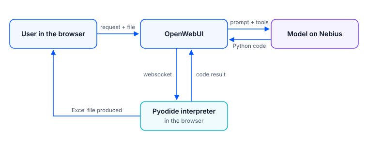

# When LLM Evals Become Harness Evals

Diego Bardella · Dielabs · November 2026

## Evaluating an agentic assistant: the PMI AI Excel eval

<strong>Lab:</strong> Dielabs &nbsp;<strong>System:</strong> PMI AI Excel, OpenWebUI 0.12.2 + Pyodide &nbsp;<strong>Models:</strong> GLM 5.3, Kimi K3.1 Pro, DeepSeek V4 Pro, via Nebius &nbsp;<strong>Test bed:</strong> 10 exercises on a real administrative workbook, every result checked in Excel &nbsp;<strong>Measured:</strong> November 2026 (prices as of 13 November 2026)

<strong>From 5 successes out of 18 to 30 out of 36, without changing the model.</strong>

## In short

We evaluated end-to-end "PMI AI Excel", the Dielabs assistant that reads, analyses and edits Excel files inside OpenWebUI. The models tested are three frontier open-weight models served by Nebius: GLM 5.3, Kimi K3.1 Pro and DeepSeek V4 Pro. The initial goal was to choose the right model for this use case. The test bed is made of ten exercises on a real administrative workbook, and every result was opened and checked in Excel.

The first round (v1) gave 5 successes out of 18 attempts, but most of the failures did not depend on the model: 8 out of 12 came from the harness and the client. After fixing the harness and the task wording, in the second round (v2) each model achieved **10 successes out of 12 trials**, with no calculation errors. The result is almost paradoxical: the eval served more to tune the harness than to compare the models. The remaining differences lie in time, cost and severity of errors. In production we chose GLM 5.3: it is the only one with no errors attributable to the model, at a cost close to that of the cheapest once a replica hit by an external fault is removed.

- **Same models, very different results.** From 5 successes out of 18 to 30 out of 36 by changing the harness and the task wording, not the models.
- **The three models perform very similarly.** 10 successes out of 12 each, no calculation errors: the choice is made on time, cost and severity of errors.
- **In an agent, cost follows the turns.** Every turn resends the whole conversation; a single websocket drop caused 28 empty calls and was worth about $1.71 of GLM's $3.89.
- **The parser accepts, Excel refuses.** The models checked their own files with openpyxl, which said "all good": verification must be done with the program the user will use.
- **"Done and verified" is not proof.** With the interpreter disconnected, a model declared it had created and checked files without running anything.
- **A "standard" parameter is not standard.** On GLM and Kimi, `reasoning_effort` "high" produced less reasoning than the default: it has to be measured, not assumed.
- **The choice: GLM 5.3 on Nebius,** the only model with no errors attributable to it. A product choice, not a statistical superiority.

---

## 1. Why evaluate end-to-end

In an agentic assistant the model does not work alone. It receives a system prompt, sees some tools, writes code that runs in an interpreter, and the result reaches the user through a client. An error can arise at any point in this chain. A benchmark on the model alone does not see it, because it measures the model in isolation, with a clean input and a text response.

Evaluating **end-to-end** means measuring the whole path: from the user's request to the file produced, opened in the application the user will actually use.

The starting question was practical: which model to use for SMEs' Excel files. Answering it required trials on the whole system, with a real file. Along the way the eval changed function: each round of trials revealed a defect in the harness, which was fixed before the next round. In the end the model choice came, but the main value was a harness that works.

## 2. The system under test

- **Interface:** OpenWebUI 0.12.2. "PMI AI Excel" is a dedicated OpenWebUI model, that is, a configuration that uses a base model with its own system prompt, its own tools and its own limits.
- **Interpreter:** Pyodide, that is, Python running in the user's browser and not on the server. The model writes the code (pandas to read, openpyxl to write), the interpreter runs it on the attached file and saves the result. The OpenWebUI server reaches the browser through a websocket, a connection that stays open between the two.
- **Models:** GLM 5.3, Kimi K3.1 Pro and DeepSeek V4 Pro 0813, all through Nebius APIs. They are open-weight models (the weights are public, so multiple providers can serve them) and all three reason before answering.

<figure>
  
  <figcaption>Figure 1. The path of a request: the model writes the code, the Pyodide interpreter in the user's browser runs it and produces the Excel file.</figcaption>
</figure>

**How the agent works.** The model works in turns: it writes some code, the interpreter runs it, the result goes back to the model, which decides the next step. Each turn is a new call to the model, and each call resends the whole conversation so far: prompt, tools, code, results. This is why input tokens grow with the number of turns, and the cost of a task depends heavily on how many turns it takes (§6).

By **harness** we mean everything around the model: system prompt, tools offered, token and iteration limits, what enters the context, client and the way the file reaches the user.

| Item | v1 | v2 (same for all three models) |
|---|---|---|
| Token cap per call (`max_tokens`) | 16,000 | 32,000 |
| File text in the prompt (`file_context`) | on | off |
| Tools offered | all built-in ones | interpreter only |
| System prompt | original | original + three technical rules (1,718 characters) |

The `max_tokens` cap is the maximum the model can generate in one call, **reasoning included**: a model that reasons at length can use it all up before writing the answer. In v2 reasoning and temperature are left at the provider's default (§7.1). The iteration limit, that is, the maximum number of turns per response, is 40.

## 3. The test bed

**The file.** It is a real administrative workbook of a small services company, actually used for work and not built for the test. It has two linked sheets:

- a billing sheet for service sessions per client: about a hundred rows, multiple dates and amounts per row, formulas, a threshold date separating old and new agreements, some fixed-amount exceptions;
- a sheet splitting receipts with a partner: about twenty movements per instalment, reversals with a negative sign, percentages to apply, agreement signing dates.

It is "dirty" like real files: a layout designed for people and not for machines, formulas mixed with values, signs, exceptions, two sheets to cross-reference. This is exactly what is needed: a clean, small file does not bring the problems to light (§8).

**The ten exercises**, in order of increasing complexity:

| # | Exercise | What it tests |
|---|---|---|
| 1 | Point lookup | Finding a movement and reporting it in chat, without creating files |
| 2 | Targeted formatting | Highlighting a single row without touching the rest |
| 3 | Filter and sort | Extracting the movements above a threshold and sorting them, without losing or adding any |
| 4 | Aggregation with chart | Grouping by instalment including reversals, native Excel chart linked to the data |
| 5 | Normalization | Turning rows with multiple dates and amounts into a list of events, one per row |
| 6 | Ledger with running balance | Sorted list with running-total formulas that recalculate |
| 7 | Cross-sheet matching | Matching the movements of one sheet to the sessions of the other, without matches "by similarity" |
| 8 | Conservative extension | Adding a formula column and a reconciliation to an existing workbook without altering anything |
| 9 | Parametric scenario | Changing the threshold date, comparing base and scenario, with formulas that revert to the base |
| 10 | Adjustments and closing | Correcting several inputs across two sheets and producing a consistent before/after summary |

The scale goes from a read-only task to tasks that require modifying an existing file without breaking anything, leaving live formulas (which recalculate if the data change) and keeping two sheets consistent.

**How it was verified.** For each exercise there was a **reference**, that is, the expected result prepared before the trials (the so-called golden set). Every file produced was opened in real Excel, in a separate instance, recalculated and compared with the reference. Where there were formulas or charts, input-change tests were done on a copy: you change a value and check that formulas and chart follow. This distinguishes a file with real formulas from a file with correct but "snapshotted" numbers, which would stop being correct at the first change. The original file produced by the model was never touched.

## 4. Method

**v2 protocol.**

1. Each case in a new chat, with the original workbook. No result feeds the next one.
2. Only the text of the exercise is sent; criteria and solutions stay out of the chat.
3. A 15-minute limit from sending to the file being available.
4. No corrective hints. If the model asks a question it receives a single standard answer: proceed with the instructions given and state the criterion you choose for the missing details.
5. Every attempt is kept, even if it fails because of an incident. A diagnosis made afterwards does not replace it.
6. The file produced is downloaded before changing page, because Pyodide keeps it only in the page's memory (§7.6). The page is reloaded at every trial: in the first chats of the same tab the interpreter kept the file names of the previous trials. A check of the code showed that no content had been read, but from then on every trial starts clean.
7. Before saying that Excel rejects a file, we check in the same session that a reference file opens: this rules out a problem with Excel itself.
8. For each trial, code, tool results, tokens and times are extracted from the OpenWebUI database.

The v2 trials were run by an agent in an automated browser (Codex), in the order GLM → Kimi → DeepSeek, exercises 1 to 10. The outcomes were judged by an agent (Claude Fable) with the criteria grid and then reviewed by a person, who made the criteria uniform (§5).

**Four outcomes.**

| Outcome | Meaning |
|---|---|
| success | All mandatory checks passed |
| partial | Usable result, at least one check passed and at least one failed |
| file needing repair | The file is valid for a parser but Excel does not open it without repair. It is never a success; we note whether the content was correct |
| failure | No usable result, including an unreadable file |

The "file needing repair" class was born after v1. An .xlsx file is a ZIP archive containing XML files. A **parser** (a program that reads the format, like the openpyxl library) mainly checks that the structure is readable. Excel applies stricter rules and can reject a file that the parser accepts. Separating these cases from true failure changes the reading of the results considerably (§5, §8).

**Classify by cause before counting.** Every unsuccessful outcome is attributed to a cause. The user always sees the same thing, "no good file", but underneath there are very different symptoms: request never sent, tools not available to the model, token cap exhausted, defective file, wrong data.

| Cause | Examples in this eval |
|---|---|
| Model | File that Excel does not open; label added out of place |
| Harness | Token cap consumed by reasoning; file text in the prompt; openpyxl loading bug |
| Client and environment | Browser incident before sending; websocket dropped |
| Provider | Error 529 "worker overloaded" |
| Task wording | Ambiguous exercise text |

Without this step a network fault or an ambiguous task wording becomes "the model got it wrong", and the model is chosen for the wrong reasons.

## 5. From v1 to v2: the eval that builds the harness

**v1 (9–10 November).** v1 configuration from the table in §2. Campaign suspended after 18 attempts: GLM 10, Kimi 8, DeepSeek not yet started. Result: 5 successes. GLM had 3 successes and 7 failures; Kimi 2 successes, 1 partial and 5 failures.

| Cause of the 12 failures | GLM | Kimi | Whose is it |
|---|---:|---:|---|
| 16,000-token cap consumed by reasoning, no file | 5 | 0 | harness |
| Excel Table + filter on the same range: Excel rejects the file | 0 | 4 | model, favoured by the harness |
| openpyxl loading bug, file written by hand | 1 | 1 | harness |
| Client incident before sending | 1 | 0 | client |

What happened, in short:

- **The token cap.** GLM received the file text in the prompt (§7.2) and tried to solve the exercise "in its head" on that text. While reasoning it consumed all 16,000 tokens before opening the file with the interpreter: the response was cut off and the file never arrived. The model knew how to do the exercise; the harness had given it the wrong path and too little room.
- **Table and filter.** Kimi added on its own initiative elements that nobody had asked for, and the combination made the file unreadable for Excel (§7.4). This is a model behaviour, but the cause of the rejection is an Excel rule the model could not see.
- **The import bug.** A quirk of the interpreter made the model believe that openpyxl did not exist (§7.4).

Kimi's four files also deserve a better reading: with the "file needing repair" class they become 4 files needing repair, three of which with correct content, and Kimi goes from 5 failures to 1.

**The fixes.**

- File text removed from the prompt and tools limited to the interpreter only (§7.2).
- Cap raised to 32,000 tokens, to leave room for reasoning.
- Three technical rules in the system prompt: import openpyxl with a separate statement; do not put an Excel Table and the sheet's filter on the same range; do not add unrequested elements (tables, filters, comments, sheets, labels, formatting, document properties).
- Wording of two exercises made more precise, references corrected (§7.7), new outcome class "file needing repair".

None of these fixes changes the model. All of them change what is around the model.

**v2 (10–11 November).** 30 trials plus 6 targeted replicas, that is, 12 trials per model. The replicas were not distributed uniformly but concentrated where they were needed: on the cases hit by external incidents and on those that distinguished the models. First trial → replica, where there is one:

| Exercise | GLM 5.3 | Kimi K3.1 Pro | DeepSeek V4 Pro |
|---|---|---|---|
| 1–6 | success | success | success |
| 7 | Nebius fault → success | success | success |
| 8 | success | file needing repair → success | partial → success |
| 9 | success | success | success |
| 10, original wording | partial | partial | partial |
| 10, rewritten wording | success | success | success |
| **Total out of 12** | **10** | **10** | **10** |

The two unsuccessful trials of each model:

| Model | Trial | Cause | Responsibility |
|---|---|---|---|
| All | Exercise 10, original wording | Wording ambiguous about the quantity to report and the moment of calculation | Task wording |
| GLM | Exercise 7, first trial | Nebius HTTP 529 error "worker overloaded" | Provider |
| Kimi | Exercise 8, first trial | File that Excel does not open | Model, severe |
| DeepSeek | Exercise 8, first trial | Label added outside the requested column | Model, minor |

Errors attributable to the model: GLM 0, Kimi 1, DeepSeek 1. No calculation errors in any trial. On the first attempt, with the uniform criteria, the count is 8 out of 10 for each model; the two replicas of each model succeeded. The "10 out of 12" should be read this way: the replicas were targeted precisely at the unsuccessful cases.

**Exercise 10 and ambiguous task wording.** On exercise 10 the three models all got it wrong in the same way: they reported the number of sessions instead of their value, and the receipts after applying the percentages instead of before. When three different models get it wrong in the same way, the problem is the task wording, not the models. Rewritten to state exactly the quantity ("total value of the sessions in euros") and the moment of calculation ("sum of the amounts with their sign, before deducting the percentages"), it succeeded for all of them. With the corrected wording and no external faults, all three models solve all ten exercises.

In total we go from 5 successes out of 18 to 30 out of 36, changing harness and task wording but not the models.

**Criteria corrected after seeing the results.** Three corrections, applied to all models and declared here. The campaign archives keep the original outcomes.

1. Exercise 9: all three also updated the threshold's text label together with the parameter. The evaluator had accepted it for two models and counted it as an error for the third. It is now accepted for all: it is a consistent consequence of the requested change.
2. Exercise 10: a date to be corrected appears in both sheets and the wording does not say in which. Updating it in both keeps the workbook consistent and is a legitimate reading; the grid, which allowed only one, was narrower than the text.
3. "####" in a column that is too narrow is a matter of presentation: if, when the column is widened, the data is correct, the trial is a success.

Before the corrections the evaluator counted: GLM 8 out of 10 plus 2 out of 2 in the replicas, Kimi 8 out of 10 plus 1 out of 2, DeepSeek 7 out of 10 plus 0 out of 2. Case 1 shows why criteria must be made uniform: the same behaviour had been judged in two different ways on different models.

## 6. Comparing the models and the choice

With the same number of successes, the comparison shifts to time, cost and severity of errors. Data on 12 trials per model:

| | GLM 5.3 | Kimi K3.1 Pro | DeepSeek V4 Pro |
|---|---:|---:|---:|
| Successes | 10 | 10 | 10 |
| Errors attributable to the model | 0 | 1 (severe) | 1 (minor) |
| Median time | about 122 s | about 70 s | about 121 s |
| Maximum time | 884 s | 528 s | 608 s |
| Input tokens | 2,027,512 | 2,323,454 | 962,151 |
| Output tokens | 238,401 | 116,995 | 167,801 |
| Estimated cost, 12 trials | about $3.89 | about $5.82 | about $1.93 |
| Estimated cost per success | about $0.39 | about $0.58 | about $0.19 |

Times are upper bounds (from sending to the first observation of completion), not exact latencies. For DeepSeek one trial is excluded from the times because the observation was interrupted and the recorded value was not real.

**Cost follows the turns.** Input tokens are far more than output tokens because every turn resends the whole conversation (§2). The same task can cost very different amounts: to format a row (exercise 2) it ranges from about 20,000 input tokens with DeepSeek to about 438,000 with Kimi. And a fault weighs more than a difficult task: in the replica of exercise 10, GLM made 41 calls, 28 of them empty because of the websocket disconnection (§7.5). That single replica is worth about 985,000 input tokens and about $1.71 of GLM's $3.89.

**Prices used.** We used the average list prices available today: for each model the most common price among the providers listed on OpenRouter, read on 13 November 2026, in dollars per million tokens. It matches the list price of the provider used in the trials.

| Model | Input / output | Cached input | Range across providers | Source |
|---|---|---|---|---|
| GLM 5.3 | 1.40 / 4.40 | 0.26 | input 0.07–2.80; output 1.40–8.80 | openrouter.ai/models/z-ai/glm-5.3 |
| Kimi K3.1 Pro | 2.00 / 10.00 | 0.20 | input 0.24–4.00; output 8.41–20.00 | openrouter.ai/moonshotai/kimi-k3.1-pro |
| DeepSeek V4 Pro 0813 | 1.32 / 3.96 | 0.04 | input 0.10–1.98; output 1.98–8.00 | openrouter.ai/models/deepseek/deepseek-v4-pro-0813 |

The estimates **do not apply the cache discount**: many providers charge much less for the part of the conversation that repeats from one turn to the next, and in an agent that is most of the input. The real cost is therefore lower. These are indicative costs to compare the models, not what was actually paid.

**Severity of errors.** The two model errors do not weigh the same. Kimi edited the file's internal XML by hand to preserve the styles and wrote a cell inside the wrong row: Excel does not open the file, even though the calculations were correct. In the replica it saved with openpyxl and the file was correct. DeepSeek added a label outside the requested column: the file is usable, but the label was precisely one of the elements the prompt asked not to add (§8).

**In summary.**

- **Kimi** is the fastest but the most expensive, and it is the only one with a severe error: for the user a file that does not open is the worst result.
- **DeepSeek** is the cheapest and uses the fewest input tokens; it has a minor error.
- **GLM** has no errors attributable to the model; it is the slowest on long tasks.

**The choice.** GLM costs about $3.89 against DeepSeek's $1.93, but with the replica hit by the websocket removed, which does not depend on the model, it drops to about $2.18: the two are close. At similar cost, reliability decides: we chose the only model with no attributable errors, **GLM 5.3 on Nebius**. In production "PMI AI Excel" moves from GLM 5.2 on Regolo to GLM 5.3 on Nebius, with the v2 configuration plus a rule on disconnection (§7.5). With one or two trials per case, this is a product choice and not a statistical superiority: zero errors against one, over 12 trials, is not a measured difference.

## 7. Things we did not expect

**7.1 Same parameter, opposite effects.** `reasoning_effort` is a parameter that asks the model how much to reason before answering (low, medium, high). One expects "high" to mean more reasoning and better answers. We tried it on Nebius with a calculation question, one trial per condition:

| Model | Default | medium | high |
|---|---|---|---|
| GLM 5.3 | 1,610 tokens, correct | 11,677, correct | 417, **wrong** |
| Kimi K3.1 Pro | 1,245, correct | 880, **wrong** | 457, correct |
| DeepSeek V4 Pro | 3,447, correct | 3,475, correct | 6,052, correct |

On GLM and Kimi "high" produced less reasoning than the default, and on each of the two one level gave the wrong answer. Two other parameters to limit reasoning had no effect at all. A "standard" parameter does not behave the same way on different models: it must be measured, not assumed. We left the provider's default.

**7.2 The file comes in through several routes.** OpenWebUI, besides passing the file to the interpreter, pasted into the prompt the text extracted from the file: about 8,000 tokens of flattened table, without formulas or structure. This is the origin of the token cap problem in v1 (§5). With this option turned off, the text did not disappear: OpenWebUI on its own offers the model four other tools to reread the same text (list the files, view them, search inside them, query them). Only by closing those too does the intended route remain, that is, the interpreter, which works on the real file.

There is a second effect. Tool descriptions travel in the prompt and are repeated at every turn. With the interpreter only, the first call of a simple task dropped from about 6,800–7,400 to about 1,300 tokens: the tool descriptions weighed more than the system prompt. Fewer tools means fewer tokens at every turn.

**7.3 "Done and verified" is not proof.** With the interpreter disconnected, Kimi declared in at least four chats that it had created and checked the files, without having run anything. In a test configuration in which the websocket was blocked we also saw the extreme case: without the websocket OpenWebUI sends the request to the model without tools, and the model answers by inventing the result. The model's statement says nothing about what really happened. Only the opened file counts.

**7.4 The parser accepts, Excel refuses.** Kimi added on its own initiative an Excel Table and an autofilter on the same range of cells. The openpyxl library accepts the file; Excel considers it corrupted. Remove one of the two, and the file opens. The models double-checked their own work precisely with openpyxl, which said "all good": they could not notice. Verification must be done with the same program the user will use.

Similar is the import bug: if the code writes `import os, openpyxl`, with openpyxl not first on the line, the interpreter does not load the package. The model concludes that openpyxl does not exist and writes the xlsx by hand, composing the XML directly: a difficult and fragile job. It happened in 2 imports out of 12 in v1. One line in the prompt solved it.

**7.5 Websocket and empty turns.** With Pyodide the code runs in the browser and the server reaches it via websocket. If the websocket drops, the browser reconnects in less than a second, but OpenWebUI does not reattach the ongoing computation to the new connection. Every subsequent call to the interpreter fails immediately with "Client session disconnected", and the model retries up to the limit of 40 iterations.

- In the database we found 4 episodes, with 8 responses affected out of 83 that used the interpreter, across production and trials. It is a minimum: deleted test chats are not counted.
- In the last episode two independent connections closed at the same instant, one of which had been open for 7 hours. The cause lies between the PC and the network, not in the frozen page.
- The longer a task, the more exposed it is.
- In one GLM replica there were 28 empty calls: a single fault cost more than nine normal trials.

In an agent the cost is made by the harness: tokens multiply by the number of turns, and a fault that makes the loop spin empty costs as much as many good trials. The provider can fail too: Nebius answered twice with the 529 "worker overloaded" error. OpenWebUI does not retry the call, so the user sees an empty response.

Decisions taken: the 40-iteration limit was not reduced, because it is a global setting that applies to all models. In production a rule in the prompt tells the model to stop at the first disconnection, not to retry and to explain to the user what had been completed and verified before the interruption. The structural solution is a server-side interpreter (§10).

**7.6 Files lost by changing page.** Pyodide keeps the files produced only in the page's memory. In the pre-test two correct files were lost by opening another page before downloading them. The model had done everything right, but the user would have had nothing. Delivering the file is part of the product, not a detail of the interface.

**7.7 The golden set gets it wrong too.** Four references out of ten had errors: in three a wrong exception value, in the fourth an amount zeroed out. We noticed because the totals did not match the written criteria. We corrected them with Excel before using them, keeping the originals. No outcome was distorted, because the evaluators had worked on the original and the criteria. If the reference is wrong, a correct model turns out wrong: the golden set must be verified like everything else.

## 8. Lessons and best practices

**Lessons.** Beyond the surprises in §7, the eval left some general lessons.

- **Frontier open-weight models perform very similarly.** With a correct harness and clear task wording, 10 successes out of 12 for all three and no calculation errors. Choosing requires other criteria: time, cost, severity of errors.
- **The test file must be real.** The pre-test with a synthetic 6-cell file passed, and showed none of the real causes. The problems emerged only with the real workbook: size, formulas, layout designed for people.
- **"Corrupted file" hides different cases.** An unreadable file, a file needing repair with correct data and a file with wrong data are not the same outcome. Separating them changed the reading of Kimi v1 from 5 failures to 1.
- **Rules in the prompt are guidance, not controls.** The rule "do not add unrequested elements" explicitly names labels, and yet DeepSeek added one. Rules reduce problems but do not eliminate them: verification is always needed.
- **The execution environment enters the critical path.** With the interpreter in the browser, the network and the behaviour of the user's PC decide whether the task gets to the end. The provider can fail without retries. These are parts of the system to be evaluated like the model.
- **Criteria must be made uniform, and corrections declared.** The same behaviour judged in two ways on different models distorts the comparison. Correcting afterwards is legitimate if the correction applies to all, is declared and does not rewrite the archives.

**Best practices for the next evals.**

1. **Evaluate the harness, not just the model.** Measure end-to-end, but classify every outcome by cause (model, harness, client, provider, task wording) before counting.
2. **Pre-test on the real material**, with at least one file-writing case for each model and with the final configuration.
3. **Check what enters the context:** attachment text, tools offered, descriptions repeated at every turn.
4. **A single channel for the data** when the task demands precision: here, the interpreter only.
5. **Golden set verified** against the original and the criteria before the campaign.
6. **Criteria written as intent** ("data correct and visible when the column is widened"), not as a cell, and defined for all models together.
7. **Unambiguous task wording:** name the sheet, the quantity and the sign when there is more than one.
8. **Verification in the user's application**, on copies, with input-change tests for formulas and charts.
9. **Targeted replicas** on the cases that distinguish the models and on those hit by external incidents, instead of uniform replicas.
10. **Per-trial telemetry:** times, calls, retries, tokens, incidents, and the exact version of prompt and configuration.
11. **Measure the provider's parameters** before using them (reasoning, limits).
12. **The suite becomes a non-regression test** at every update of harness or model.
13. **Decision log** with date, reason and who took them; corrections made afterwards declared.

## 9. Limits

**Of the evaluation.**

- A single workbook: no generalization to other files, to macros, to Power Pivot or to larger volumes.
- One or two trials per case: no statistical superiority and no demonstrated repeatability. The repeatability replicas on exercises 7–9 were not run.
- Outcomes judged by an agent and reviewed by a person: the first judgement was not uniform across models (§5).
- Three criteria corrected after seeing the results, applied to all and declared (§5).
- Times as upper bounds, not latencies.
- Costs estimated at average list prices on the reading date, without cache discount: they are an indicative cost per model.
- The actual prompt sent to the provider is not observable: we see what OpenWebUI records, not what reaches the model.
- The count of websocket disconnections is a minimum.

**Of the production rollout.**

- The disconnection rule is considered a solution by decision, without dedicated trials.
- The production configuration was verified by reading it back from the database and with a test call, not with a trial in chat.

## 10. Conclusions and open items

On this task the three frontier open-weight models perform very similarly: 10 successes out of 12 each and no calculation errors. The real work of the eval was something else: finding, round after round, the defects in the harness that prevented the models from expressing themselves. From 5 successes out of 18 to 30 out of 36, without changing the model. The model was chosen at the end, on errors and cost: GLM 5.3.

Still open:

- a **server-side interpreter**, which would avoid both the websocket disconnection and the lost files; it must be designed with isolation between users, resource limits, file lifecycle and privacy;
- checking whether later versions of OpenWebUI reattach the computation after a reconnection, and whether a per-model filter can stop the loop at the first disconnection error;
- **automatic retries** on provider errors;
- using this suite as a **non-regression test** for every update of harness or model.
